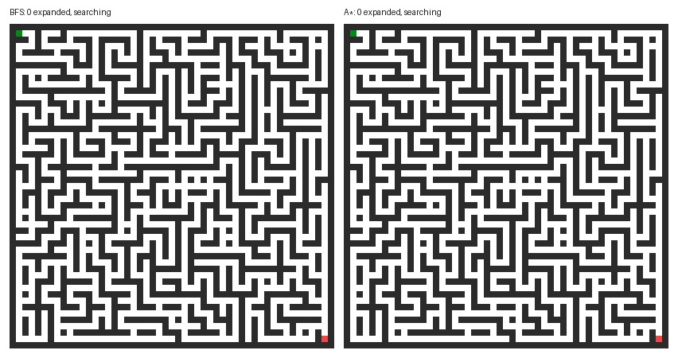

# Maze Runner

**Comparing uninformed and heuristic search in grid mazes: when does the A\* heuristic stop helping?**
CS3346A Introduction to Artificial Intelligence, Fall 2026, Group 26.

A reproducible Python experiment that generates seeded mazes, runs BFS, UCS, A\* and greedy
best-first search through one shared graph-search loop on exactly the same instances, checks every
returned path with an independent verifier, and analyses when the Manhattan heuristic helps.



## Quick start

Requires Python 3.12 or newer (developed and run on 3.13).

```
python -m venv .venv
.venv\Scripts\activate            # Windows;  source .venv/bin/activate on macOS/Linux
pip install -r requirements.txt
pip install -e .
```

| Command | What it does | Time |
|---|---|---|
| `python -m pytest -q` | All tests (generator, hand-traced known answers, lecture example, properties, verifier, runner) | a few seconds |
| `python run_all.py --quick` | Tests, then a small check run (10×10 and 25×25, 5 seeds) with tables and figures in `results/quick/` | about a minute |
| `python run_all.py` | Tests, the full final experiments, tables, figures, and the report | about 15 minutes |
| `python run_all.py --suite dev` | The same experiments on the development seeds | about 15 minutes |

`python run_all.py` rewrites `results/final/`. Two runs give identical `runs.csv` files except
for the three timing columns. To check that without touching the submitted results:

```
python -m maze_runner.experiment config/final.json --out results/repro_check
python tools/compare_runs.py results/final/runs.csv results/repro_check/runs.csv
```

## The report

The submitted report is `report/ieee/Maze_Runner_IEEE.pdf` (IEEE conference template). It is
generated from the same script and results as the Word version, so the two cannot disagree:

```
python report/build_report.py --ieee      # writes report/ieee/Maze_Runner_IEEE.tex and figures
cd report/ieee
pdflatex Maze_Runner_IEEE.tex             # run three times (needs a LaTeX install; IEEEtran.cls is included)
```

`python report/build_report.py` (no flag) writes the Word version, `report/Maze_Runner_Final_Report.docx`.

## Layout

```
config/               experiment settings (written by tools/make_configs.py)
src/maze_runner/
  generator.py        perfect, looped and weighted mazes from a seed
  problem.py          the search problem: state, actions, costs, neighbour order
  search.py           BFS, UCS, A*, greedy: one loop, different frontiers
  heuristics.py       zero and (scaled) Manhattan distance
  verify.py           independent path checker and reference optimum
  metrics.py          timing protocol, environment record
  experiment.py       runs a config, writes runs.csv and metadata.json
  analysis.py         runs.csv -> tables and summary.json
  visualize.py        maze pictures, charts, animated GIF
tests/                pytest suite
results/dev/          development seeds (0 to 49): used for every design choice
results/final/        final seeds (10000 and up): runs.csv, metadata.json, tables/, figures/
report/               build_report.py and the generated report (.docx)
DECISIONS.md          every choice that could move a number, logged before the final run
```

## Rules the numbers depend on

- A maze of size n is n×n cells on a (2n+1)×(2n+1) grid of squares. Start (1, 1), goal (2n−1, 2n−1).
- Four-way moves, neighbour order Up, Right, Down, Left. Entering a square costs 1, or 5 for mud; the start is free.
- Graph search with the best-g contract: push only on strict improvement, skip stale records, allow reopening.
- BFS tests the goal at generation (strongest fair baseline). UCS, A\* and greedy test it at removal.
- **Counting rule:** a node is expanded when it is removed from the frontier, is not stale, is not
  the goal, and its successors are generated. This reproduces the Week 3 lecture example exactly
  (UCS 13 / 26, greedy 65 / 9, A\* FIFO 13 / 25); see `tests/test_known_answers.py`.
- A\* heap order is (f, tie key, insertion counter); headline numbers use larger-g ties.
- Seeds: development 0 to 99; final main 10000 to 10049, sweep 20000 to 20049, weighted 21000 to
  21049, ablation 22000 to 22049. The final seeds were run once from git tag `v1.0-final-run`.

## Results in one paragraph

See `report/Maze_Runner_Final_Report.docx`, `results/final/summary.json` and
`results/final/tables/`. In short: on perfect mazes A\* saves only a few percent of the expansions
of BFS and misses the 30% target; on looped mazes it saves far more; the savings follow the
heuristic informedness h(start)/C\*; and on open grids an exact heuristic only pays off with a
tie rule that prefers deeper nodes.

## CSV columns (`runs.csv`)

`experiment, maze_type, n_cells, grid_size, seed, loop_rate, mud_rate, start, goal, open_cells,
mud_cells, maze_hash, algorithm, heuristic, weight, tie_rule, goal_test, found, expanded,
generated, peak_frontier, reached, path_len, path_cost, optimal_cost, optimal_steps, verified,
optimal, expect_optimal, h_start, informedness, detour_ratio, time_mean_ms, time_median_ms,
time_min_ms, time_runs`

`verified` is the independent verifier's verdict on the path (legal, reported cost and length
confirmed). `optimal` says whether its cost equals the verifier's own optimum. `expect_optimal`
marks configurations that guarantee optimality; the runner stops if one of them is not optimal.

